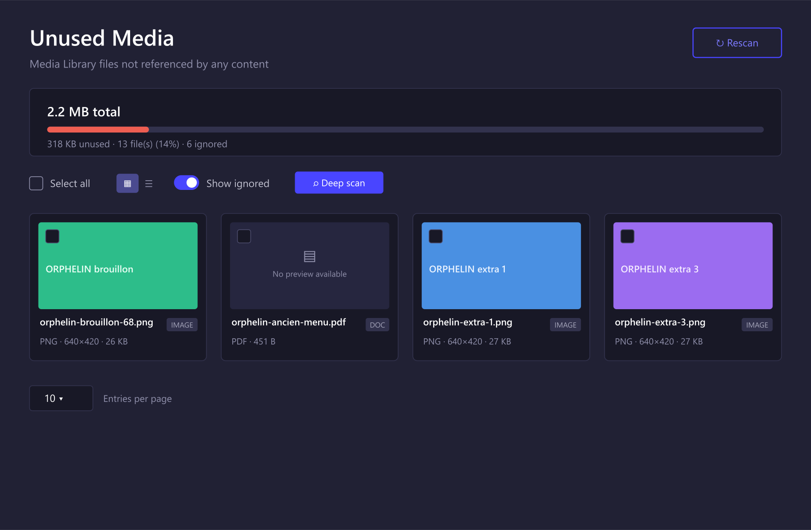
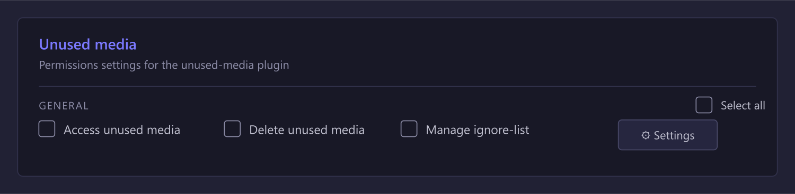
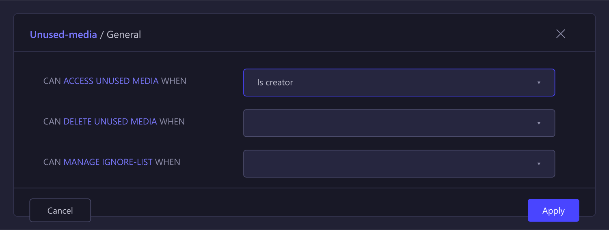

<div align="center">
  
  <h1>Strapi 5 plugin unused media</h1>
  <p>Find, review and safely clean up the media files nobody uses anymore.</p>
</div>

<p align="center">
  <a href="https://www.npmjs.com/package/strapi-plugin-unused-media">
    
  </a>
  <a href="https://www.npmjs.com/package/strapi-plugin-unused-media">
    
  </a>
  <a href="https://github.com/PaulRichez/strapi-plugin-unused-media/blob/main/LICENSE">
    
  </a>
</p>

> ⚠️ **For Strapi 5 only.** This plugin targets Strapi `^5.0.0`. It is not compatible with Strapi v4.

## 🚀 _Overview_

The Media Library grows forever — old uploads, abandoned drafts, replaced images. Strapi has no built-in way to tell which files are actually still used.

**Unused Media** scans your whole project, cross-references every file against all your content (entries, components, dynamic zones) and lists the ones referenced **nowhere**, with a preview, their size and the total storage you can reclaim.

It also handles the tricky part most tools miss: media embedded **inside rich-text and Blocks fields** (which create no relation in Strapi) — so you never delete an image that's actually shown in a body of text.

### ✨ Features

- 🔎 **Accurate unused detection** across entries, components and dynamic zones (via the polymorphic relation table).
- 📊 **Storage gauge** — total library size vs. reclaimable space.
- 🖼️ **Native Media Library look** — grid & list views, real previews, the same cards you already know.
- 🗑️ **Bulk delete** through the upload service (removes the file, its thumbnails and formats).
- 🙈 **Ignore-list** — keep a file (or a whole folder) out of the results, with a _Show ignored_ toggle and one-click restore.
- 🛡️ **Deep scan** — searches rich-text / Blocks / text content for each file's hash to catch "soft" references no relation can see.
- ✅ **Deletion safety net** — a file referenced in content is **never** deleted, even by mistake.
- 🔐 **Role-based permissions** (read / delete / manage ignore-list) with support for the _is creator_ condition.
- 🌍 **i18n** — English & French included.

## ⏳ _Installation_

With npm:

```bash
npm install strapi-plugin-unused-media
```

With yarn:

```bash
yarn add strapi-plugin-unused-media
```

Then rebuild the admin panel:

```bash
npm run build && npm run develop
```

## ✨ _Getting Started_

The plugin is enabled by default once installed. To configure it, add it to `config/plugins.ts` (or `config/plugins.js`):

```ts
export default ({ env }) => ({
  "unused-media": {
    enabled: true,
    config: {
      // Folder ids whose files are never considered unused.
      excludedFolderIds: [],
      // MIME types never flagged. A trailing "*" is a wildcard, e.g. "video/*".
      excludedMimeTypes: [],
      // Only flag files uploaded more than N days ago (0 = no age filter).
      minimumAgeInDays: 0,
      // Set to false to make the plugin strictly read-only.
      allowDelete: true,
    },
  },
});
```

### Permissions

Open **Settings → Administration Panel → Roles** and grant, per role, under the **Unused media** group:

| Action | What it allows |
| --- | --- |
| **Access unused media** | View the list, the storage gauge and run a (re)scan. Gates the menu entry. |
| **Delete unused media** | Delete files in bulk. |
| **Manage ignore-list** | Add / remove files & folders from the ignore-list. |

Each action also supports the **WHEN _is creator_** condition, so an editor can be limited to the media **they** uploaded.

### Deep scan & the "soft reference" blind spot

Media inserted in a `richtext` (markdown) or `blocks` field is stored **inline** (by url/hash) and creates **no relation** in Strapi. A plain scan would flag such a file as unused.

Click **Deep scan** to additionally search every text / rich-text / Blocks column for each candidate's hash. Files found in content are marked **Referenced**, locked and protected from deletion. The same check always runs as a safety net at deletion time.

## 🎉 _Result_

The dashboard, with the storage gauge, the native-style cards and the toolbar (grid/list, _Show ignored_, _Deep scan_):



The role permissions, with the three actions and the _is creator_ condition:





## 🐛 _Bugs_

Found a bug or have a feature request? Please open an issue on the [GitHub repository](https://github.com/PaulRichez/strapi-plugin-unused-media/issues).

## License

[MIT](./LICENSE) © [Paul Richez](https://github.com/PaulRichez)
